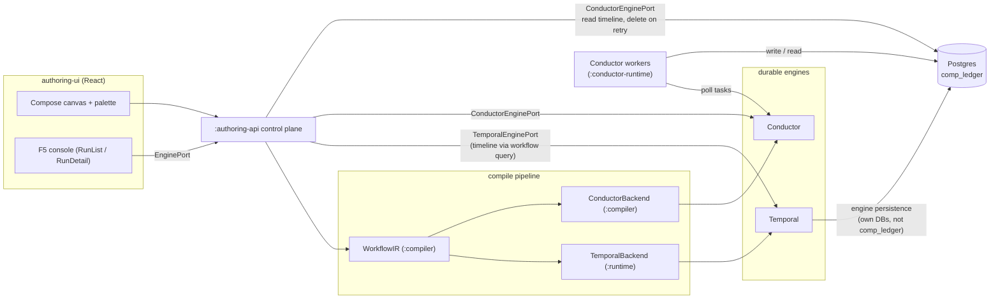
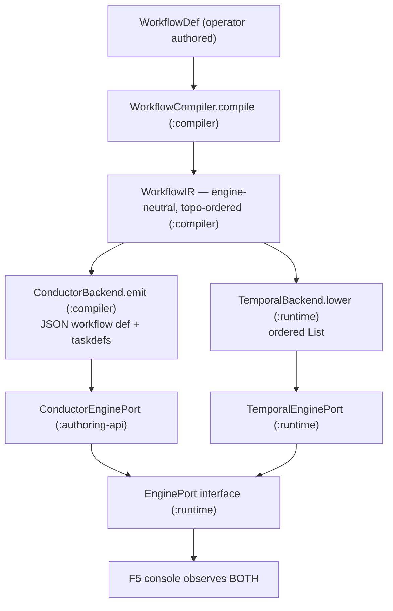
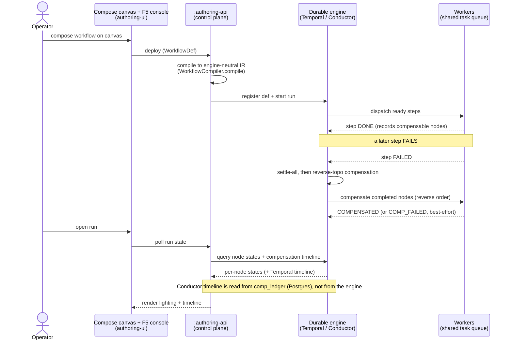
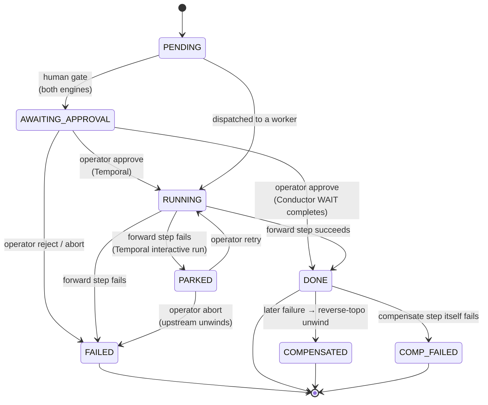
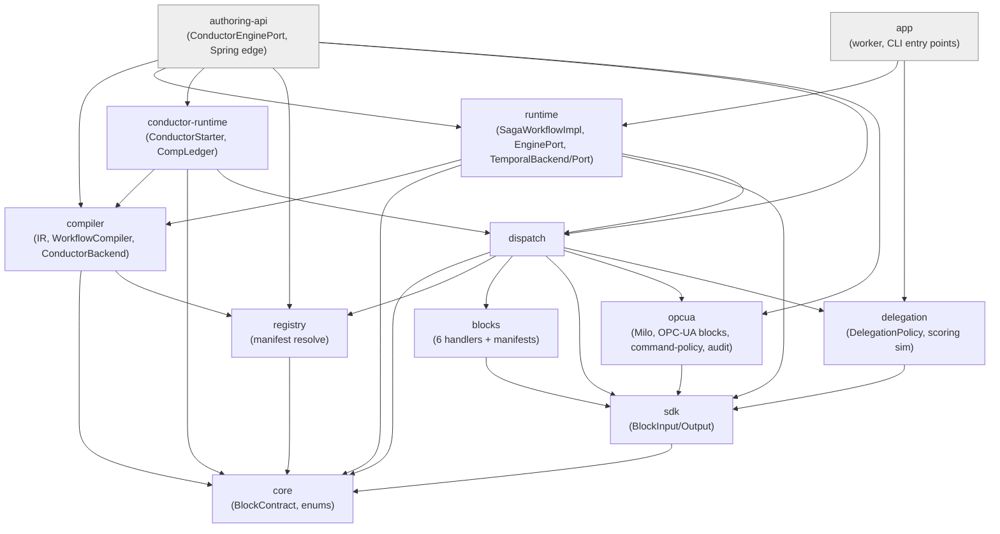
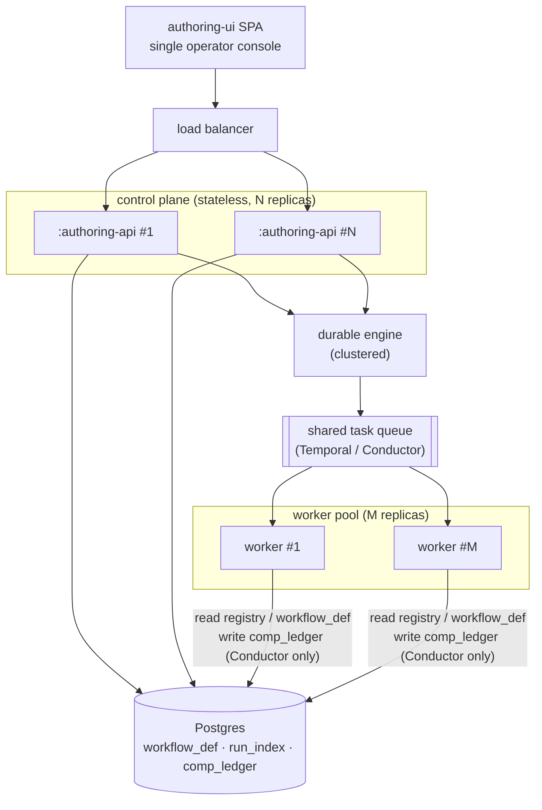

# Koshei — Architecture (as-built)

## 1. Purpose and the hard problem

Koshei is the saga platform, which composes and runs contract-driven durable sagas on Temporal or
Conductor for transactional OT/IT integration. In these workflows, the final step is often an
irreversible side-effect, such as writing a recipe to a PLC, and the people composing the canvas are
operators who do not write code. The hard problem is ensuring that every step dragged onto the
canvas guarantees idempotent re-execution after a crash, ordered compensation of committed work when
a later step fails, bounded retry, and a human approval gate before anything irreversible, all
without the author writing orchestration code.

The episode outer loop moved to [incident-recovery](https://github.com/picasso-robotics/incident-recovery)
(formerly koshchei) on 2026-10-05, and this document covers only the saga platform. Drift auto-correct no
longer has an episode mode, and `KOSHEI_PICASSO` is not read. Drift auto-correct acts on OPC UA
recipes, and incident-recovery acts on picasso's robots, so the two no longer act on the same things.

## 2. System overview

The authoring UI (a React app) projects the block registry into a palette and lets an operator
compose a workflow on a canvas. That definition is sent to the `:authoring-api` control plane, which
**compiles** it to an engine-neutral IR and lowers it to a concrete engine: Temporal (via
`TemporalBackend` in `:runtime`) or Conductor (via `ConductorBackend` in `:compiler`). Workers
execute the block handlers; durable state lives in Postgres. The F5 operator console observes runs
on both engines through one `EnginePort` seam.

On Conductor, the `:conductor-runtime` workers (`ForwardWorker` and `CompensateWorker`) write and read
the `comp_ledger` table in Postgres; the control plane's `ConductorEnginePort` reads that table for
the compensation timeline and deletes the run's rows before a retry. On Temporal, the compensation
timeline is in-workflow state that `TemporalEnginePort` reads with a workflow query, and Temporal
never touches `comp_ledger`.

## 3. The keystone — block contract drives derived resilience

Every block ships a declarative `BlockContract` (`core/src/main/kotlin/koshei/core/Contract.kt`)
loaded from a YAML manifest. The runtime derives all resilience behaviour generically from these
fields, with no per-workflow orchestration code. The mapping is:

| Contract field | Enum / shape | Derived behaviour | Where consumed |
| --- | --- | --- | --- |
| `idempotency` | `IdempotencyStrategy{NONE,KEY_DEDUP,UPSERT,NATURAL}` + `keyExpression` | dedup of input rows before the forward call | `SagaWorkflowImpl.run` (KEY_DEDUP branch) |
| `compensation` | `Reversibility{REVERSIBLE,MITIGATABLE,IRREVERSIBLE}` + `CompensationKind{STATIC,CONTEXTUAL,NONE}` | which completed nodes are eligible for compensation | `SagaWorkflowImpl` / `CompensationOrder` |
| `retry` | `RetrySpec(maxAttempts, initialMs, maxMs)` | Temporal `RetryOptions`; Conductor `retryCount` | `SagaWorkflowImpl`, `ConductorBackend.emitTaskDefs` |
| `human` | `HumanSpec(requireApprovalBefore)` | park before the step for operator approve/reject | `SagaWorkflowImpl` gate; Conductor `WAIT` task |
| `compensation.reversibility == IRREVERSIBLE` | — | also forces a human gate (cannot undo, so confirm first) | `SagaWorkflowImpl`; `ConductorBackend.needsWait` |

The `actuate` manifest (`blocks/src/main/resources/manifests/actuate.yaml`) is the canonical example:
`compensation.reversibility: IRREVERSIBLE`, `kind: NONE`, `human.requireApprovalBefore: true`,
`retry.maxAttempts: 1`, `sideEffects: [ACTUATION]`. The author's workflow never asks for approval;
the contract does, and both engines honour it: Temporal via the
`Workflow.await { approved || rejected || aborted }` gate, and Conductor by compiling that node into
a `WAIT` task (`ConductorBackend.needsWait` → `taskFor`, type `WAIT`, 24h taskdef timeout).

## 4. Engine neutrality — compile once, run on two engines (the headline)

The control plane compiles an operator's workflow **once** into an engine-neutral `WorkflowIR`
(`compiler/src/main/kotlin/koshei/compiler/Ir.kt`, produced by `WorkflowCompiler.compile`), then a
backend lowers that single IR to a concrete engine. The contract is the carrier: each `IrNode`
holds the resolved, version-pinned `BlockContract`, so both backends read the same resilience facts.

The module placement across compiler and runtime boundaries is deliberately **asymmetric**:

- **Compiler and IR**: The IR and `WorkflowCompiler` live in `:compiler`.
- **Conductor backend**: `ConductorBackend` lives in `:compiler` as pure data (Jackson only, no
  Conductor runtime), emitting a Conductor workflow-definition JSON. It self-validates by
  round-tripping the output (`ConductorBackend.validate`), so the server is not required to compile.
- **Temporal backend**: `TemporalBackend` lives in `:runtime` (not `:compiler`), because lowering to
  Temporal is trivial: the saga is contract-driven, so it projects the IR's per-node contracts in
  order (`TemporalBackend.lower` = `ir.nodes.map { it.contract }`).
- **Engine ports**: The `EnginePort` interface lives in `:runtime`. `TemporalEnginePort` is in
  `:runtime`; `ConductorEnginePort` is in the `:authoring-api` edge, so that `:conductor-runtime`
  itself never depends on Temporal or on `koshei.runtime`.

**Boundary invariants** (verified, see §8): Measured on 2026-10-04, `:conductor-runtime/src/main`
contains 0 `io.temporal` imports and 0 `koshei.runtime` imports. Spring Boot is a dependency of
`:authoring-api` only; `:app` is a plain Kotlin application with no Spring dependency. Sources in
`:core / :registry / :compiler / :dispatch` contain 0 `org.springframework` imports, and assert 7 of
`run-authoring-gate.sh` checks that the `:core`, `:registry`, `:compiler` and `:dispatch` jars carry
no `org.springframework`.

**Engineering note (R-1).** Conductor abort does not rely on the engine's failureWorkflow dispatch.
On conductor-standalone 3.15.0, `terminateWorkflowWithFailure(id, reason,
triggerFailureWorkflow=true)` terminates the run but does not dispatch the registered
failureWorkflow, leaving `comp_ledger` uncompensated. `ConductorStarter.abortWithCompensation`
therefore self-dispatches the `<name>-compensation` workflow with the `{workflowId: <id>}` input
Conductor would inject on failure; its compensate tasks then read the forward run's ledger entries
and unwind them. This behaviour is documented in code and proven by
`run-conductor-retry-abort-gate.sh`.

## 5. Durable saga execution

`SagaWorkflowImpl` (`runtime/.../SagaWorkflowImpl.kt`) implements the contract-driven Temporal saga:

- **Promise-graph concurrency.** It builds a `Promise<BlockOutput>` per node over the topo-ordered
  IR; each node awaits its upstream promises, so independent branches run concurrently.
- **Settle-all, never fail-fast.** On failure it settles every branch first (`Promise.handle` +
  `Promise.allOf`, the sdk-java #902 non-determinism mitigation) before compensating, so partial
  parallel failure is handled deterministically.
- **Reverse-topological compensation.** As nodes complete, `SagaWorkflowImpl` records the compensable
  ones (the eligibility predicate `reversibility != IRREVERSIBLE && kind != NONE`); on failure,
  `CompensationOrder.reverseTopological` walks the topo list in reverse over that
  completed-and-compensable set to produce the unwind order. Compensation is **best-effort**: a
  failing compensate step records `COMP_FAILED` and continues unwinding the rest.
- **Human gate before irreversible.** When a node contract has `requireApprovalBefore` or is
  IRREVERSIBLE and the run is not auto-approved, the node is set to `AWAITING_APPROVAL` while the
  workflow waits for approve, reject or abort. The gate is evaluated once, outside the operator
  retry ("park") loop (where a failed step on an interactive run enters `PARKED` to await retry or
  abort), so one approval covers every forward retry. Reject or abort at the gate marks the node
  `FAILED` and is terminal: it propagates into settle-all, then compensation.
- **Crash recovery.** `scripts/run-crash-recovery.sh` kills the worker mid-flight; Temporal replays
  the in-flight activity on restart and the run completes.
- **Conductor saga state.** Conductor's failureWorkflow cannot carry in-memory saga state, so
  `CompLedger` (`conductor-runtime/.../CompLedger.kt`) externalizes it in Postgres, keyed by
  **PK `(workflow_id, node_id)`** — exactly one row per compensable node per run, so parallel
  branches sharing a `blockId` never collide. The compensation timeline is read back from this
  ledger ordered by reverse-topo `idx`.

The canonical scenario `ot-recipe-apply` (`scripts/fixtures/compose/ot-recipe-apply.json`) exercises
this end to end: `sensorRead`(db.read) → `recordPlan`(db.upsert) → `interlockAck`(notify.email) →
`preflight`(transform.map) → `applyPLC`(actuate, IRREVERSIBLE + gate).

The **run lifecycle** traces execution from the operator's compose action through compile, deploy,
start, step failure, reverse-topological compensation, and observation in the F5 console:

*When a step fails, completed reversible work unwinds in reverse-topological order and the IRREVERSIBLE PLC actuation never fires, as enforced by contract.*

## 6. Operator surfaces

- **Authoring UI palette** projects the block registry so operators see the registered,
  version-pinned blocks; manifest `label`/`help`/`widget` fields drive the field UI.
- **Compose canvas** is built on React Flow; the library supplies graph mechanics, and the visual
  design comes from the project's own design system.
- **F5 console** (`authoring-ui/src/views/console/{ConsoleView,RunList,RunDetail}.tsx`) shows run
  history, per-node lighting, the compensation timeline, and interventions ("Approve", "Reject",
  "Abort"). It is engine-tagged for both engines: `RunList` displays an engine chip, and `RunDetail`
  branches the retry affordance. Temporal offers a per-node "Retry" on a parked node; Conductor has
  no parked-node primitive, so it offers "Retry (whole run)". Conductor retry and
  abort are implemented in `ConductorEnginePort.signalRetry/signalAbort`: `signalRetry` ignores the
  node id, clears the run's compensation ledger, and re-runs the workflow from the start, while
  `signalAbort` calls `abortWithCompensation`.

Console lighting is driven by a fixed **per-node state set**: the eight-value `NodeState` union in
`authoring-ui/src/types.ts` (`PENDING | RUNNING | DONE | FAILED | COMPENSATED | PARKED |
COMP_FAILED | AWAITING_APPROVAL`), rendered as `ns-*` CSS classes in
`authoring-ui/src/views/compose/BlockNode.tsx`. Node states are derived engine-side by
`SagaWorkflowImpl` for Temporal and by `ConductorNodeStates.kt` for Conductor. The node lifecycle is:

`AWAITING_APPROVAL` indicates a gated node awaiting operator decision: Temporal sets this state
when a node contract has `requireApprovalBefore` or is IRREVERSIBLE (unless auto-approved), while
Conductor maps an in-progress `WAIT` task to `AWAITING_APPROVAL` in `ConductorNodeStates.kt`.
Approval continues execution (completing the `WAIT` task to `DONE` on Conductor), while a reject
or abort marks the node `FAILED` and triggers compensation. `PARKED` exists only on Temporal
interactive runs: when a forward step fails, the node enters `PARKED` to await an operator
decision, where retry runs the step again (`RUNNING`) and abort marks it `FAILED` to unwind
completed compensable nodes. On non-interactive runs a failing step transitions straight to
`FAILED`, and Conductor never emits `PARKED` because it has no parked-node primitive.
`COMPENSATED` vs `COMP_FAILED` records whether a node's compensate step succeeded — compensation is
best-effort, so a failed compensate is recorded as `COMP_FAILED` and the rest of the unwind
continues (§5).

## 7. Module map and dependency graph

Twelve Gradle modules (from `settings.gradle.kts`; `authoring-ui` is the React app, not a Gradle
module). Edges point in the direction of dependency (A → B means A depends on B). The diagram shows
the architecture-carrying edges, not every edge. Edges omitted from the diagram: `runtime` →
`registry`, `blocks`; `conductor-runtime` → `registry`, `blocks`, `sdk`; `authoring-api` → `core`,
`blocks`; and `app` → `core`, `registry`, `blocks`, `compiler`, `opcua`. Each module's
`build.gradle.kts` (including `app/build.gradle.kts`) provides the full list.

**Boundary rules baked into this graph:** `:conductor-runtime` depends on `:compiler`/`:core` but
not on `:runtime` or `io.temporal`. Spring Boot is a dependency of `:authoring-api` only; `:app` is
a plain Kotlin application (the Temporal worker and the CLIs) with no Spring
dependency, so `:core / :registry / :compiler / :dispatch` stay framework-free.
`ConductorEnginePort` is hoisted into `:authoring-api` to keep `:conductor-runtime` clean of the
`EnginePort` (Temporal) seam.

## 8. Verification strategy

The test suite reports **541 tests, 0 failures** across the 12 Gradle modules via `./gradlew test`
(opcua 115 · authoring-api 105 · registry 102 · runtime 52 · compiler 47 · conductor-runtime 39 ·
delegation 20 · blocks 17 · core 17 · app 15 · dispatch 7 · sdk 5). Outside Gradle, `authoring-ui`
type-checks clean (`tsc --noEmit`) and runs 42 vitest tests. The disposable de-risking spike is
excluded from these figures. Engine-touching tests use Testcontainers (real Postgres, Temporal, and
Conductor), development is TDD, and there are 34 gate scripts (`scripts/run-*-gate.sh`) plus a
Playwright E2E-to-GIF harness (`scripts/run-e2e.sh`, specs in `authoring-ui/e2e/`) and a
crash-recovery harness (`scripts/run-crash-recovery.sh`).

The table maps each headline capability to the artifact that proves it; it lists only some of the
gate scripts:

| Capability | Proving artifact |
| --- | --- |
| Compile to engine-neutral IR | `run-compiler-ir-gate.sh` |
| DAG wiring + topo order | `run-dag-gate.sh` |
| Temporal concurrency (promise graph) | `run-concurrency-gate.sh` |
| Conductor concurrency (FORK_JOIN/JOIN) | `run-conductor-concurrency-gate.sh` |
| Per-node states / canvas lighting | `run-node-states-gate.sh`, `run-conductor-node-states-gate.sh` |
| Compensation timeline (both engines) | `run-compensation-timeline-gate.sh`, `run-conductor-comp-timeline-gate.sh` |
| Human gate + interventions | `run-intervention-gate.sh` |
| Conductor retry/abort + R-1 self-dispatch | `run-conductor-retry-abort-gate.sh` |
| Conductor end-to-end execution | `run-conductor-exec-gate.sh` |
| Plugin block on Conductor (published while the worker runs) | `run-conductor-plugin-gate.sh` |
| Console (both engines) | `run-console-gate.sh`, `run-conductor-console-gate.sh` |
| Add-a-block / authoring / compose-run | `run-add-block-gate.sh`, `run-authoring-gate.sh`, `run-compose-run-gate.sh` |
| Full OT scenario | `run-scenario-gate.sh` |
| Governed OPC UA apply through Heimdall over NCMD | `scripts/run-r2-ncmd-gate.sh` (builds Heimdall from `BIFROST_DIR`; requires `scripts/run-add-block-gate.sh` to have published the example plugin against the same database first) |
| Crash recovery (Temporal) | `run-crash-recovery.sh` |

## 9. Scale-out & deployment topology

This section covers whether the backend can scale out under load while the frontend stays a single
portal. It does so **by design**, subject to the as-built caveat at the end of the section.

- **Backend scales horizontally.** Workers poll a shared task queue, so throughput increases by
  adding worker replicas without code changes. On Temporal, `app/.../Worker.kt` starts a
  `WorkerFactory` worker that polls the shared `koshei-v0_1-tq` task queue (`factory.start()`). On
  Conductor, `conductor-runtime/.../ConductorWorkerMain.kt` boots one `ForwardWorker` per block id
  the registry knows (the builtins and every published plugin block, task type = blockId) plus a
  `CompensateWorker`, all polling Conductor via `TaskRunnerConfigurer`. Additional replicas add
  pollers competing for the same queue.
  The `:authoring-api` control plane is a thin, mostly stateless edge: durable state lives in
  Postgres (`workflow_def`, `run_index`, `comp_ledger`) and in the engine, so the control
  plane can run multi-replica behind a load balancer (its only per-process state is an idempotent
  deploy-dedupe cache, which is safe to lose). The durable engines themselves (Temporal and
  Conductor) are clustered, horizontally scalable systems.
  Among the workers, only the Conductor workers write `comp_ledger`; the control plane reads it and
  deletes a run's rows on retry; a Temporal worker keeps the compensation timeline in workflow
  state, which the control plane reads with a workflow query.
- **Frontend stays a single portal.** The React `authoring-ui` is a static SPA, one
  operator console; load does not scale the frontend. Operators control and observe
  workflows through one window regardless of how many workers run, so worker scale remains
  transparent to the operator. This is a stated design principle.

**As-built limit.** The repository implements a single-process local demo: one worker, one
`:authoring-api`, and a docker-compose stack. Scale-out is designed for, not deployed, and no
multi-replica measurement is recorded in this repository. Architectural seams make it possible
(poll-based workers on a shared queue, a stateless externalized-state control plane, and clustered
engines), but a multi-replica Kubernetes / HPA / Helm deployment is not built, and the architecture
is kept non-breaking toward it. See §10.

## 10. Honest limits and non-goals (current)

- **Crash-recovery is demonstrated on Temporal only** (`run-crash-recovery.sh`); the Conductor path
  is not exercised by an equivalent kill-and-replay harness.
- **Conductor node-state overlay is eventually consistent.** Because conductor-standalone indexes
  asynchronously, the COMPENSATED overlay surfaces after a short grace-poll window
  (`RunDetail.tsx` TERMINAL_GRACE).
- **OT connector limits.** The `actuate` block in `ot-recipe-apply` models an IRREVERSIBLE
  side-effect and drives no hardware. The `:opcua` module's `opcua.write` and `opcua.call` blocks
  are exercised by `run-opcua-gate.sh` only against an embedded Milo OPC-UA simulator, on Temporal
  only. There is no PLC protocol. The OPC UA client supports only security `None` and `Double`-only
  writes, and `opcua.call` is a Boolean trigger plus rising-edge poll rather than a UA Method call.
  The Ignition gate (`run-ignition-interop-gate.sh`) has no recorded result in this repository; its
  NodeIds were browsed from a live Ignition server (2026-07-02).
  The Sparkplug B NCMD gate (`scripts/run-r2-ncmd-gate.sh`) runs koshei's `opcua.write` / `opcua.call`
  over Sparkplug B NCMD (`KOSHEI_APPLY_MODE=ncmd`) through Heimdall, Bifrost's command edge (built
  from a bifrost checkout given as `BIFROST_DIR`), with the embedded Milo OPC UA simulator at the far
  end. `scripts/run-add-block-gate.sh` must have published the example plugin against the same
  database first, because the worker binds every bundled workflow at start. The NCMD gate passed on
  2026-11-10: happy path, repeated activate, human veto with reverse NCMD restore, a rogue command for
  an unlisted node denied by Heimdall, an out-of-range rogue value denied by Heimdall, and fail-closed
  when Heimdall is down. The outbound governance-event gate (`run-outbound-emit-gate.sh`) is
  cross-repo with `resequence-twin-lab` as the Sparkplug host; this document records no result for it.
  Nothing has run against field equipment.
- **Single-version Conductor definitions.** A Conductor definition is keyed by bare `name`; a
  Temporal one by `name@version`; multi-version Conductor is future work
  (`ConductorEnginePort` limitation note).
- **E2E/GIFs run locally and on demand**, not in continuous CI.
- **Product and demand axis is unvalidated.** Koshei is an engineering artifact, not a
  market-proven product.

## 11. Design rationale and decision record

- `docs/scenario-ot-actuation-demo.md` — the deep walkthrough of the `ot-recipe-apply` scenario.
- `docs/usage.md` — the **Using & Extending Koshei** developer guide: run it, author your own block (the SDK + `:app:cli` scaffold/publish flow), operate, and configure.

